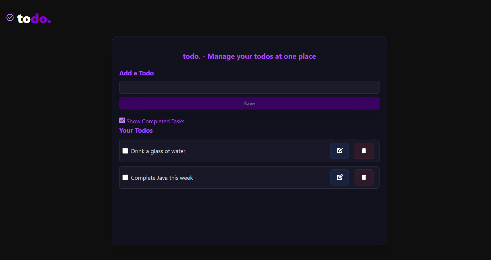

# Todo App

A simple and responsive Todo application built using React and Tailwind CSS.

## Features

- Add new tasks
- Edit existing tasks
- Delete tasks
- Mark tasks as completed
- Show or hide completed tasks
- Save todos using Local Storage
- Responsive dark-themed UI

## Screenshot



## Technologies Used

- React.js
- Tailwind CSS
- JavaScript
- Local Storage
- React Icons
- UUID

## Installation

1. Clone the repository:

   ```bash
   git clone https://github.com/satyajitsethi7/To-Do-List.git
   ```

2. Navigate to the project folder:

   ```bash
   cd To-Do-List
   ```

3. Install dependencies:

   ```bash
   npm install
   ```

4. Start the development server:

   ```bash
   npm run dev
   ```

## Author

Developed with ❤️ using React.